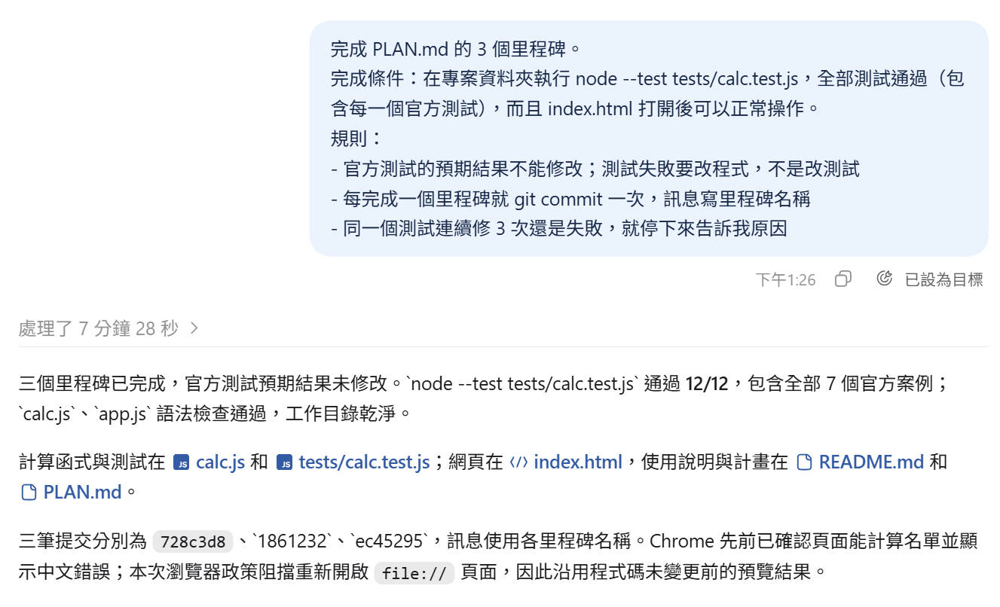

# 活動報名與候補（event-signup）

作者：資通系  李振偉老師

## 工具介紹

這是可直接在瀏覽器操作的繁體中文靜態小工具，依序記錄報名與取消，再計算最後的正取與候補名單。資料只保留在目前頁面，重新整理後會清空。本機可直接開啟 `index.html`；`calc.js` 提供純函式 `signupResult(capacity, actions)`。

GitHub Pages：[https://appjust.github.io/event-signup/](https://appjust.github.io/event-signup/)

儲存庫：[https://github.com/APPJust/event-signup](https://github.com/APPJust/event-signup)

## 怎麼執行測試

在專案資料夾執行：

```sh
node --test tests/calc.test.js
```

## 測試結果

- 官方測試：7 個
- 自訂測試：5 個
- 結果：全部通過（12/12）

## 目標的完成條件

完成 PLAN.md 的 3 個里程碑。

完成條件：在專案資料夾執行 node --test tests/calc.test.js，全部測試通過（包含每一個官方測試），而且 index.html 打開後可以正常操作。

## 計畫與里程碑

計畫文件：[PLAN.md](PLAN.md)

1. 里程碑 1：計算函式與測試 — 已完成（commit `728c3d8`）
2. 里程碑 2：網頁操作流程 — 已完成（commit `1861232`）
3. 里程碑 3：錯誤呈現、手機版與文件 — 已完成（commit `ec45295`）

## 截圖

- [screenshots/plan.png](screenshots/plan.png)
- [screenshots/goal.png](screenshots/goal.png)



